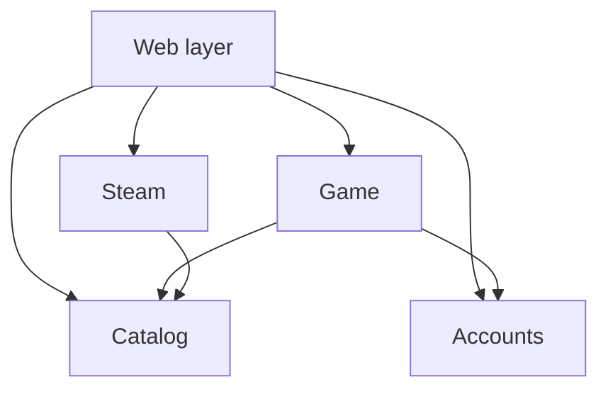
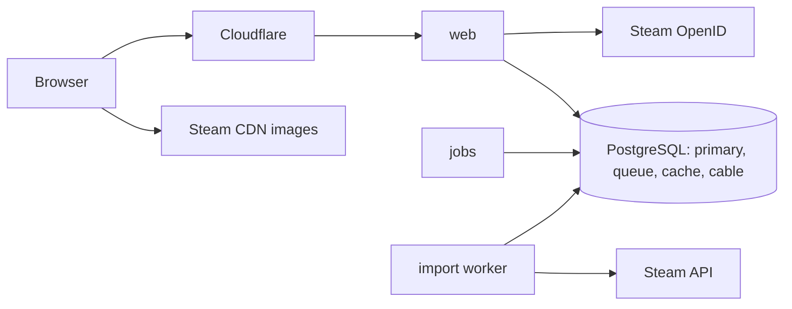
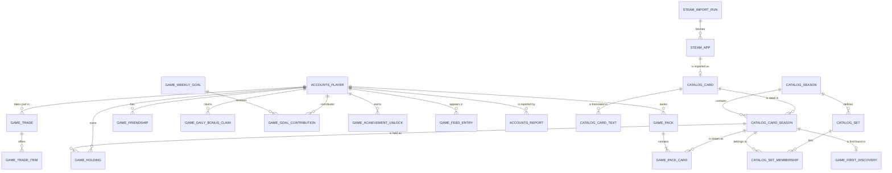

# Architecture Spine — gameble

## Design Paradigm

A **modular monolith with an operations layer**: one Rails application, four domain packs with a fixed dependency direction, and a thin web layer. Every state change is a named operation.

| Layer | Directory | Holds |
| --- | --- | --- |
| `Catalog` | `packs/catalog` | Cards, card texts per locale, seasons, a card's rarity and dust tier for a season, sets |
| `Steam` | `packs/steam` | Steam API client, import jobs, raw Steam data, import runs, sign-in verification |
| `Accounts` | `packs/accounts` | Players, staff roles, bans, reports, data controls |
| `Game` | `packs/game` | Pack bank, owned cards, trades, friendships, weekly goal, daily bonus, achievements, events and their handlers |
| Web layer | `app/` | Controllers, policies, view components, React components, back-office |
| Image filter | `packages/pixel-art-filter` | Standalone browser package |

## Invariants & Rules



### AD-1 — Four packs and a thin web layer `[ADOPTED]`

- **Binds:** all
- **Prevents:** game rules scattered across controllers, callbacks, jobs and components.
- **Rule:** Domain code lives in one of the four packs. The web layer holds no game rule: it calls operations and queries, renders, and authorizes.

### AD-2 — Dependency direction, enforced `[ADOPTED]`

- **Binds:** all
- **Prevents:** Steam leaking into the engine; packs growing circular references.
- **Rule:** Only the arrows of the diagram above are allowed. `Catalog` and `Accounts` depend on no pack. No pack depends on the web layer. Packwerk checks this in CI; a violation fails the build.

### AD-3 — Every state change is an operation `[ADOPTED]`

- **Binds:** all
- **Prevents:** two sessions mutating the same state by different paths.
- **Rule:** A state change is a `dry-operation` class in the pack that owns the data, wrapped in one database transaction, returning `Success` or `Failure(code)`. Controllers, jobs, handlers and components never write a model directly. Reads go through queries owned by the pack. An operation may call another operation of its own pack; across packs it follows the allowed direction or reacts to an event (AD-10).

### AD-4 — Steam is an adapter `[ADOPTED]`

- **Binds:** CAP-1, CAP-2, CAP-3
- **Prevents:** an engine that cannot be forked onto another catalog.
- **Rule:** `Steam` is the only code that knows Steam. It keeps raw Steam responses in its own tables, computes a prestige score, and writes cards into `Catalog`. `Catalog` and `Game` never reference a Steam-specific field.

### AD-5 — The catalog is published by season `[ADOPTED]`

- **Binds:** CAP-2, CAP-3, CAP-4, CAP-6
- **Prevents:** a half-imported catalog being drawn from; rarities drifting under owned cards.
- **Rule:** An import fills a draft season. `Catalog::PublishSeason` turns scores into the 5 tiers, builds the sets and makes the season visible at once. Draws read only the published season. Rarity and dust tier live on the card-season record and never change after publication.

### AD-6 — Owned cards are counted, not listed `[ADOPTED]`

- **Binds:** CAP-4, CAP-6, CAP-8, CAP-11
- **Prevents:** a table growing by billions of rows; two models of ownership.
- **Rule:** A player's cards are one row per player and card-season, with a `quantity` and a `reserved` count. There is no row per copy. Database check constraints keep `quantity >= reserved >= 0`. An operation that touches several of these rows locks them in ascending order of player then card-season.

### AD-7 — Packs are pre-drawn `[ADOPTED]`

- **Binds:** CAP-4, CAP-5, CAP-12, CAP-16
- **Prevents:** draws at click time, per-player scheduled tasks, and several ways of granting a pack.
- **Rule:**
  - A player's bank holds ten pre-drawn packs, each with its 5 cards and an availability time. Pack credit is read from those times; no task runs per player.
  - A new player's bank is filled by a `Game` handler reacting to `Accounts::PlayerRegistered`, with the first-session guarantee of the spec.
  - A replacement pack becomes available ten minutes after the latest availability time in the bank, or ten minutes after the opening when the bank was full.
  - `Game::OpenPack` locks the player's bank, consumes one available pack, credits the 5 cards, publishes its event, and tops the bank back up to ten in the same transaction (`Game::TopUpBank`): each replacement is drawn at once from the in-memory pool. No job draws packs, and no undrawn pack exists.
  - A draw picks the tier by the published odds, then a card uniformly within the tier, with secure randomness, from an in-memory list of the published season.
  - Bonus and reward packs are rows of the same table, outside the cap of ten.
  - The reveal is a browser animation. The server keeps no flip state.
  - Opening reads a pre-drawn pack and writes at most 5 counted rows, which keeps it within the spec's 200 ms p95.

### AD-8 — Trades reserve cards `[ADOPTED]`

- **Binds:** CAP-11
- **Prevents:** a card promised twice; partial transfers; deadlocks.
- **Rule:** Two friends have at most one open trade. Placing a card raises `reserved` on its row; declining, cancelling and expiry lower it. Acceptance is one transaction that locks both players' rows in the order of AD-6, moves the cards and closes the trade. A counter-proposal replaces the current offer and hands the turn over. A periodic job closes expired trades.

### AD-9 — No row is written by every player `[ADOPTED]`

- **Binds:** CAP-12, CAP-13, CAP-16, CAP-17
- **Prevents:** lock queues on a hot row.
- **Rule:** Shared figures are derived from per-player rows. Uniqueness is left to the database: one daily-bonus row per player and UTC day, one first-discovery row per card-season, one reward row per player and week.

### AD-10 — Events are the only bridge to derived data `[ADOPTED]`

- **Binds:** CAP-12, CAP-13, CAP-14, CAP-17
- **Prevents:** a feed, gauge or achievement computed three different ways; personal data frozen in a log.
- **Rule:**
  - Each operation publishes one Rails Event Store event inside its transaction. Events are never modified.
  - A handler runs in that transaction and writes only rows of that player or new rows: a feed entry, a weekly contribution, an achievement.
  - Totals across players (the gauge) are summed by one periodic job.
  - State tables are the truth; events are not replayed to rebuild them.
  - Events carry identifiers only. Deleting an account anonymises the player record.
  - When the dependency direction forbids a call, a pack reacts to another pack's event.

### AD-11 — A separate read path `[ADOPTED]`

- **Binds:** CAP-6, CAP-7, CAP-8, CAP-13, CAP-18
- **Prevents:** a rewrite when a read replica is added.
- **Rule:** Requests that only read and tolerate a second of delay run under the database `reading` role. At the start that role points to the primary.

### AD-12 — Backends are swapped by configuration `[ADOPTED]`

- **Binds:** all
- **Prevents:** code tied to one queue, cache or pub/sub product.
- **Rule:** Jobs go through Active Job, caching through `Rails.cache`, real time through Turbo Streams. No code calls Solid Queue, Solid Cache or Solid Cable directly. Recurring schedules are configuration, not code.

### AD-13 — Broadcasts are batched and leave after commit `[ADOPTED]`

- **Binds:** CAP-12, CAP-13
- **Prevents:** broadcasts of uncommitted state; one message per event at high load.
- **Rule:** Broadcasts are sent by a job, never inside a transaction. The gauge is broadcast about every ten seconds; feed entries leave in small batches. Feed and gauge streams are public. The choice of what enters the feed lives in one handler.

### AD-14 — Identity and access `[ADOPTED]`

- **Binds:** CAP-1, CAP-14, CAP-15, CAP-18
- **Prevents:** a second sign-in path; an unprotected mutation; a ban that takes effect late.
- **Rule:**
  - Sign-in is Steam only, through OmniAuth and `omniauth-openid`; the Steam-specific verification lives in `Steam` and hands a Steam id to `Accounts`.
  - The session is an encrypted cookie holding only the player id. Each request reloads the player and checks the ban.
  - Every controller action has a Pundit policy. Every `Game` operation requires a player as input.
  - Roles: signed-out visitor, player, moderator, administrator.

### AD-15 — No internal id in a URL `[ADOPTED]`

- **Binds:** CAP-7, CAP-8, CAP-9, CAP-10
- **Prevents:** counting or enumerating players.
- **Rule:** Players are addressed by a random token, cards by a slug. Database ids never appear in URLs, HTML or JSON.

### AD-16 — Server-rendered pages, two React islands `[ADOPTED]`

- **Binds:** CAP-5, CAP-11, and every screen
- **Prevents:** a second application growing in the browser.
- **Rule:**
  - Pages are rendered by Rails with ViewComponent and Hotwire.
  - React is used for the pack reveal and the trade board only, mounted with Turbo Mount and written in TypeScript.
  - A component receives its initial data and its translated strings as props. Each player action calls a server endpoint that runs an operation.
  - There is no client-side router and no global client store.
  - Styles are plain CSS; the tokens of `DESIGN.md` are CSS custom properties.

### AD-17 — The image filter is a standalone package `[ADOPTED]`

- **Binds:** CAP-5, CAP-6, CAP-7, CAP-8
- **Prevents:** several implementations of the card art treatment; code that cannot be published.
- **Rule:** Pixelation and reduction to 16 colours live in `packages/pixel-art-filter`, in TypeScript, with no dependency on gameble. The card view component and the React components both use it. Images are loaded from Steam's CDN and never stored.

### AD-18 — One place for copy `[ADOPTED]`

- **Binds:** all
- **Prevents:** strings translated in two places; a locale shipped incomplete.
- **Rule:** All interface copy lives in Rails locale files, in French and English, and follows `brotherhood-tone.md`. The locale is the first segment of the URL. Card text per locale lives in `Catalog`. CI fails on a key missing in either locale.

### AD-19 — The import is a separate, resumable process `[ADOPTED]`

- **Binds:** CAP-2, CAP-3
- **Prevents:** play depending on Steam; an import that cannot be watched or resumed.
- **Rule:** Import jobs run on their own queue with one throttled worker, resume after interruption, and write idempotently. An administrator starts a run by hand. Each run has a record with its step, counts and errors, shown in the back-office.

### AD-20 — Proven gems first `[ADOPTED]`

- **Binds:** all
- **Prevents:** each session re-implementing a solved problem its own way.
- **Rule:** Use a long-proven, maintained gem when one fits. Write custom code only when none does. A new dependency is added to the Stack table with its version.

### AD-21 — One image, three processes `[ADOPTED]`

- **Binds:** all
- **Prevents:** deployment choices that block scaling out.
- **Rule:**
  - One container image runs as three processes: web, jobs, import worker. Kamal 2 deploys them.
  - App instances are stateless. Configuration comes from environment variables only.
  - PostgreSQL has four logical databases: primary, queue, cache, cable. Each can move to its own server.
  - `strong_migrations` refuses a migration that would block the database.
  - Cloudflare sits in front. Sentry receives errors. Backups exist before launch.

### AD-22 — What CI refuses `[ADOPTED]`

- **Binds:** all
- **Prevents:** untested rules in a language without static types.
- **Rule:** Tests are Minitest with fixtures. Each operation is tested for success and for every failure. The draw has a statistical test against the published odds. Each policy is tested, including for the signed-out visitor. Each key flow of `EXPERIENCE.md` has one end-to-end test. CI fails on a test failure, a pack boundary violation, a missing translation or an unsafe migration.

## Consistency Conventions

| Concern | Convention |
| --- | --- |
| Naming: tables | Prefixed by pack: `catalog_cards`, `game_holdings`, `accounts_players`, `steam_apps`. |
| Naming: operations | `Pack::VerbNoun`: `Game::OpenPack`, `Game::AcceptTrade`, `Catalog::PublishSeason`. |
| Naming: events | `Pack::NounVerbed`, past tense: `Game::PackOpened`, `Game::TradeAccepted`, `Accounts::PlayerDeleted`. |
| Naming: rarity tiers | Integers 1 to 5, named steel, emerald, sapphire, amethyst, gold. Defined once, in `Catalog`. |
| Ids | `bigint` primary keys inside; public token or slug outside (AD-15). |
| Time | Stored and computed in UTC. A day is a UTC day. A week is an ISO week starting Monday 00:00 UTC. |
| Failures | An operation fails with a symbol code. Its message is the locale key `errors.<pack>.<code>`. |
| JSON errors | `{ "error": { "code": "…", "message": "…" } }` with the matching HTTP status. |
| Randomness | `SecureRandom` for every draw. |
| Pagination | Pagy. |
| Abuse | Rails `rate_limit` on mutating endpoints; edge protection at Cloudflare. |
| Locales | `fr` and `en`. The first visit follows the browser language. |
| Accessibility | The accessibility floor of `EXPERIENCE.md` applies to every view and React component. |

## Stack

Verified against the RubyGems and npm registries on 2026-10-02. If a gem lags behind Ruby 4.0 at scaffold time, fall back to Ruby 3.4.11.

| Name | Version |
| --- | --- |
| Ruby | 4.0.7 |
| Rails | 8.1.4 |
| PostgreSQL | 18 |
| Puma | 8.0.2 |
| Thruster | 0.1.26 |
| Kamal | 2.12.0 |
| Solid Queue | 1.7.0 |
| Solid Cache | 1.0.10 |
| Solid Cable | 4.1.0 |
| Mission Control Jobs | 1.3.1 |
| Turbo (turbo-rails) | 2.0.23 |
| Stimulus (stimulus-rails) | 1.3.4 |
| ViewComponent | 4.15.0 |
| Vite Rails | 3.11.1 |
| Vite | 8.3.2 |
| React | 19.3.0 |
| TypeScript | 7.0.2 |
| Vitest | 5.0.3 |
| Turbo Mount | 0.4.4 |
| @hotwired/turbo-rails (npm) | 8.0.23 |
| @hotwired/stimulus (npm) | 3.2.2 |
| turbo-mount (npm) | 0.4.4 |
| react-dom | 19.3.0 |
| @types/react, @types/react-dom | 19.3.0 |
| @vitejs/plugin-react | 6.1.1 |
| stimulus-vite-helpers | 3.1.0 |
| dry-operation | 1.1.0 |
| Rails Event Store | 3.2.0 |
| Packwerk | 3.3.1 |
| packs-rails | 0.1.0 |
| OmniAuth | 2.1.4 |
| omniauth-openid | 2.0.2 |
| omniauth-rails_csrf_protection | 2.0.1 |
| rexml (needed by ruby-openid; Ruby 4 no longer bundles it) | 3.4.4 |
| cgi (needed by ruby-openid for `CGI.parse`; Ruby 4 keeps only `cgi/escape`) | 0.5.2 |
| Pundit | 2.5.2 |
| FriendlyId | 5.7.0 |
| Pagy | 43.6.3 |
| Faraday | 2.14.4 |
| faraday-retry | 2.4.0 |
| strong_migrations | 2.8.0 |
| i18n-tasks | 1.1.2 |
| http_accept_language | 2.1.1 |
| sentry-rails | 7.1.0 |
| rack-attack | 6.8.0 |

## Structural Seed





```text
gameble/
  app/
    controllers/      # thin; admin/ holds the back-office
    policies/         # Pundit
    components/       # ViewComponent: card, text plate, buttons
    frontend/         # Vite entrypoints, React components (TypeScript), Stimulus controllers
    views/
  packs/
    catalog/          # models, queries, operations
    steam/            # API client, import jobs, raw data, sign-in verification
    accounts/         # models, operations
    game/             # models, queries, operations, events, handlers, jobs
  packages/
    pixel-art-filter/ # standalone TypeScript package
  config/locales/     # fr, en
  test/               # Minitest, fixtures
```

## Capability → Architecture Map

| Capability / Area | Lives in | Governed by |
| --- | --- | --- |
| CAP-1 Steam sign-in | `Steam`, `Accounts`, web layer | AD-4, AD-14 |
| CAP-2 Catalog import | `Steam`, `Catalog` | AD-4, AD-5, AD-19 |
| CAP-3 Rarity | `Steam` (score), `Catalog` (tiers) | AD-4, AD-5 |
| CAP-4 Packs | `Game` | AD-3, AD-6, AD-7 |
| CAP-5 Reveal | React island, image filter | AD-7, AD-16, AD-17 |
| CAP-6 Collection and sets | `Game` (holdings), `Catalog` (sets) | AD-5, AD-6, AD-11 |
| CAP-7 Card detail | web layer, `Catalog` | AD-11, AD-15, AD-18 |
| CAP-8 Public profile | web layer, `Accounts`, `Game` | AD-11, AD-14, AD-15 |
| CAP-9 Share link | web layer | AD-15 |
| CAP-10 Friends | `Game` | AD-3, AD-15 |
| CAP-11 Trades | `Game`, React island | AD-6, AD-8, AD-16 |
| CAP-12 Weekly goal | `Game` | AD-7, AD-9, AD-10, AD-13 |
| CAP-13 Feed | `Game` | AD-10, AD-11, AD-13 |
| CAP-14 Data controls | `Accounts`, `Game` (by event) | AD-10, AD-14 |
| CAP-15 Reports and moderation | `Accounts`, back-office | AD-14 |
| CAP-16 Daily bonus | `Game` | AD-7, AD-9 |
| CAP-17 Achievements | `Game` | AD-9, AD-10 |
| CAP-18 Signed-out visit | web layer, `Game` | AD-11, AD-14 |

## Deferred

- **Prestige formula and tier thresholds:** calibrated on the first real import (open question in the spec).
- **Achievement list, booster odds, weight of a trade in the weekly goal:** product questions still open in the spec; the structures above hold whatever is chosen.
- **Feed selection thresholds:** tuned with real activity; the rule lives in one handler (AD-13).
- **Event retention and partitioning:** decide when the event tables pass 50 million rows.
- **Read replica:** added when the primary's read load is measured as the limit; AD-11 makes it a configuration change.
- **Dedicated real-time or job backend:** when Solid Cable or Solid Queue is measured as the limit; AD-12 makes it a configuration change.
- **Weekly goal target formula:** how the target scales with weekly active players; the weekly goal row and the periodic job carry it.
- **`omniauth-openid` on Rails 8.1:** checked when the app is scaffolded. If it does not work, the OpenID check is written inside `Steam`, as AD-20 allows.
- **Staging environment, backup schedule and restore drill:** set before launch.
- **K3s:** only if Kamal on several servers stops being enough.
- **Publishing the image filter:** an npm package, then a Rails gem wrapper; a side quest outside the MVP. AD-17 keeps it extractable.
- **Admin interface gem:** the back-office starts as plain Rails pages plus Mission Control Jobs.
- **Market, seasons after the first, native apps:** later versions; AD-5, AD-6 and AD-7 already carry the season.
