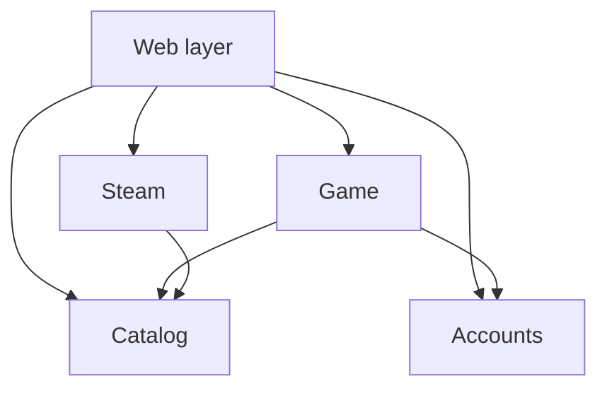
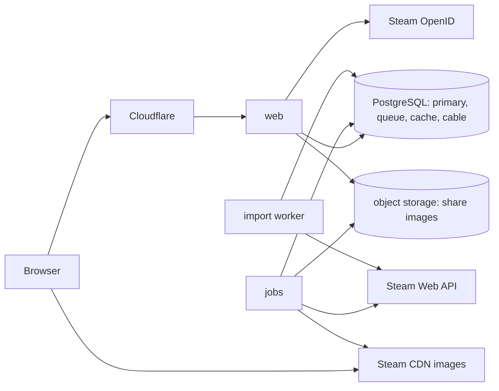

# Architecture Spine — gameble

## Design Paradigm

A **modular monolith with an operations layer**: one Rails application, four domains with a fixed dependency direction, and a thin web layer. Every state change is a named operation.

| Layer | Directory | Holds |
| --- | --- | --- |
| `Catalog` | `app/domains/catalog` | Cards, card texts per locale, the theme list, seasons, a card's rarity and number for a season, sets and their tiers, the share preview images, the roadmap's milestones and their stories |
| `Steam` | `app/domains/steam` | Steam API client, import jobs, raw Steam data, import runs, sign-in verification |
| `Accounts` | `app/domains/accounts` | Players, staff roles, last seen, profile visibility, preferences, bans, reports, data controls |
| `Game` | `app/domains/game` | Pack bank, owned cards, trades, invitations, friendships, set tiers reached, custom sets and the Steam library set, active goals, card backs, profile titles, menu themes, weekly goal, daily bonus, achievements, feed, presence activity, events and their handlers |
| Web layer | `app/` | Controllers, policies, view components, Stimulus controllers and the screen modules behind them, jobs that chain several domains (`app/jobs`), back-office, legal page |
| Image filter | `app/frontend/lib/card_art` | The card-art worker and renderer, on the `pixelcrush` npm package |

## Invariants & Rules



### AD-1 — Four domains and a thin web layer `[ADOPTED]`

- **Binds:** all
- **Prevents:** game rules scattered across controllers, callbacks, jobs and components.
- **Amended 2026-10-27:** the four packs are now domains (AD-32); the rule below says domain where it said pack, and its reasons stand.
- **Rule:** Domain code lives in one of the four domains. The web layer holds no game rule: it calls operations and queries, renders, and authorizes. Nothing anywhere takes real money: no purchase, no ad, no cash-out.

### AD-2 — Dependency direction, enforced `[ADOPTED]`

- **Binds:** all
- **Amended 2026-10-27:** the packs are domains (AD-32); the arrows are unchanged.
- **Prevents:** Steam leaking into the engine; domains growing circular references.
- **Rule:** Only the arrows of the diagram above are allowed. `Catalog` and `Accounts` depend on no pack. No domain depends on the web layer. Packwerk checks this in CI, naming each domain by its path under `app/domains`; a violation fails the build.

### AD-3 — Every state change is an operation `[ADOPTED]`

- **Binds:** all
- **Prevents:** two sessions mutating the same state by different paths.
- **Rule:** A state change is a `dry-operation` class in the pack that owns the data, wrapped in one database transaction, returning `Success` or `Failure(code)`. Controllers, jobs, handlers and components never write a model directly. Reads go through queries owned by the pack. An operation may call another operation of its own pack; across packs it follows the allowed direction or reacts to an event (AD-10).

### AD-4 — Steam is an adapter `[ADOPTED]`

- **Binds:** CAP-1, CAP-2, CAP-3, CAP-6, CAP-27
- **Amended 2026-10-30:** a player's own library is read for their Steam library set (AD-36).
- **Prevents:** an engine that cannot be forked onto another catalog; Steam data about players kept beyond need.
- **Rule:**
  - `Steam` is the only code that knows Steam. It keeps raw Steam catalog responses in its own tables and writes cards into `Catalog`. `Catalog` and `Game` never reference a Steam-specific field; a card's image is an opaque `image_url`.
  - `Steam` computes the prestige score from the review score and review count only, and hands `Catalog` a source-neutral rating and the review count, which the hall of fame sets read.
  - `Steam` hands `Catalog` each game's tags, most-voted first, as opaque keys, and its developers and franchises as Steam names them. It computes no genre and no theme: the theme list, its names and a card's main theme belong to `Catalog`.
  - The only Steam data kept about a player is the Steam id and the persona name, refreshed at each sign-in. A player's library is read only to sync their Steam library set (AD-36): `Steam` keeps no raw library response, and the list lives only as that set's games in `Game`. Playtime and Steam achievements are never read.

### AD-5 — The catalog is published by season `[ADOPTED]`

- **Binds:** CAP-2, CAP-3, CAP-4, CAP-6, CAP-7, CAP-20, CAP-22, CAP-23
- **Prevents:** a half-imported catalog being drawn from; rarities, numbers, genres, sets or tier thresholds drifting under owned cards; two readers computing a theme or a tier two ways; editions counted differently by the counter, the album and the tier pass.
- **Rule:**
  - An import builds a staged batch beside the draft: each card-season's scores (score, score version, rating, review count) are written to `catalog_staged_card_seasons`, keyed by a batch token the run passes in, and the draft is not touched. The administrator reviews the finished batch (gap with the draft, rarity spread, preview) and `Catalog::PromoteStagedBatch` replaces the draft's card-seasons with it in one transaction, or `Catalog::DiscardStagedBatch` deletes it. Promotion is refused when the season the run began on was published since (the batch is then stale and discarded). A card's identity keeps refreshing in place. While a batch waits, `PublishSeason` refuses. `Catalog::PublishSeason` turns scores into the 5 tiers, gives every card of the season its number by a random shuffle (`SecureRandom`), builds the sets and makes the season visible at once. Only `PublishSeason` assigns numbers; a season published before numbers existed gets them once, by the same shuffle.
  - Draws read only the published season.
  - Rarity, number, review count, main theme and set memberships belong to the card-season and never change after publication. `PublishSeason` records each card-season's main theme once, as the key of one of its theme sets; every reader reads that, never the card's current tags. A card in the UFOs has no main theme and shows no genre.
  - Set kinds are `theme`, `franchise`, `studio`, `hall_of_fame` and `ufo`. A set is identified across seasons by its kind and key: a theme's key is the theme list's key, never a tag name; a franchise's or studio's key is its parameterized Steam name; hall of fame keys are fixed; the UFOs' key is `ufos`. Display names are stored in the set's params at publication; theme and hall of fame names come from the locale files. Code catalogues and a player's chosen title name sets by kind and key.
  - The theme list (keys, French and English names) and the set constants (franchise and studio minimum, hall of fame thresholds, the tier table by set size, the UFOs' share limit) live in `Catalog`, in code until Season preparation moves the theme list to back-office data.
  - Tiers: every set is tiered by its distinct card count at publication, from the table in `Catalog` (`catalog-and-rarity.md`): zero to five tiers named by rank (`novice`, `apprentice`, `adept`, `expert`, `master`) counted from the top: the last tier before `complete` at 100 % is always `master`, and a set with fewer tiers drops ranks from `novice` up. Seasons published before the table keep `bronze`, `silver`, `gold` and `complete`; the tier checks accept both families and no row is renamed. A tier name gives a rank within its set, never a share: readers order a set's tiers by required count, and rank tiers of different sets by required count over the set's cards. `PublishSeason` writes each set's tiers as rows (set, tier, distinct cards required, rounded up from the shares); `Game` and every query read those rows, so tuning the shares changes only later publications. A player holds a card when its quantity is above zero.
  - The three tier checks (`catalog_set_tiers`, `game_set_tiers`, `game_feed_entries`) are widened expand/contract (AD-21): the wider check added unvalidated, validated in a second migration, then the narrow one dropped.
  - A player holds a set's member when they hold, with quantity above zero, a card-season of that member's card in any season. Holdings stay one row per card-season (AD-6): the minted season is the copy's edition. Readers use one of two measures, neither filtered by season: games, through `Game::HeldGames` (distinct games at their best minted rarity: the collection tile, the total counter, set progress, the album, and the tier pass, which shares its SQL), and copies (quantities per minted rarity across editions: the rarity counter and AD-23's counts before opening). The rarity legend (CAP-6) counts editions, one card-season each (author, 2026-10-30): its season row reads the published season's card-seasons of each rarity and those the player holds; its overall row reads the card-seasons of every published season at their minted rarity and those held; a draft season and a tribute season (AD-33) count in neither. Its totals count editions, so they differ from the top bar's game counter by design.
  - The retired kinds (`publisher`, `tome`, `best_of_year`) are removed once, before the public launch, by a migration that deletes their sets, memberships, tiers and completion rows in every season, then narrows the set kind check to the five kinds; production never held them. A season published with them (staging's first) keeps its card-seasons with no set and no main theme; nothing rebuilds a published season's sets.
  - A card's identity (texts, publisher, developers, franchises, release date, store and image URL) is shared by its seasons and follows Steam: it is refreshed by the import (`Catalog::UpsertDraftCard`), by AD-19's image refresh, and once by the backfill of developers and franchises from the stored Steam items, nothing else.

### AD-6 — Owned cards are counted, not listed `[ADOPTED]`

- **Binds:** CAP-4, CAP-6, CAP-8, CAP-11
- **Prevents:** a table growing by billions of rows; two models of ownership.
- **Rule:** A player's cards are one row per player and card-season, with a `quantity` and a `reserved` count. There is no row per copy. Database check constraints keep `quantity >= reserved >= 0`. An operation that touches several of these rows locks them in ascending order of player then card-season.

### AD-7 — Packs are pre-drawn `[ADOPTED]`

- **Binds:** CAP-4, CAP-5, CAP-12, CAP-16, CAP-23
- **Prevents:** draws at click time, per-player scheduled tasks, several ways of granting a pack, and an earlier edition drawn after a publication.
- **Rule:**
  - A player's bank holds ten pre-drawn regular packs, each with its cards and an availability time. Pack credit is read from those times; no task runs per player. A new player's ten packs are all available at once.
  - Each pack kind (regular, daily bonus, weekly reward) fixes its card count and its odds table: 5 cards at the published odds for a regular pack, 3 at the bonus odds for the daily bonus.
  - A new player's bank is filled by a `Game` handler reacting to `Accounts::PlayerRegistered`, with the first-session guarantee of the spec.
  - A replacement pack becomes available ten minutes after the latest availability time in the bank, or ten minutes after the opening when the bank was full.
  - `Game::OpenPack` takes the player's bank lock, consumes the oldest available pack of the requested reserve, credits its cards, publishes its event, and, for a regular pack, draws its one replacement in the same transaction (`Game::TopUpBank`) at once from the in-memory pool. A bank already short of ten, left so by openings while no season was published, stays short: an opening never fills it. The only other drawer is `Game::HealBanksJob`, which, when a season is published, gives every short bank all its missing packs at once, available at once, and redraws every unopened pack of an earlier season in the published one, with the same kind, odds, guarantees and availability time, one player per transaction under the bank lock.
  - A draw picks the tier by the pack kind's odds, then a card uniformly within the tier, with secure randomness, from an in-memory list of the published season.
  - Every pack whose kind is not regular belongs to the special reserve, which has no cap: claiming the daily bonus or a goal reward never fails for a full reserve (author, 2026-10-28). The regular reserve keeps its cap of 10 and its replacement of an opened pack. The bank lock still serialises claims and openings.
  - The reserves shown to the player are the available unopened regular packs and, apart, the available unopened special packs as one total; the hub, the top bar and the pack screen read both from one query.
  - `Game::OpenPack` takes the reserve it is asked for, regular or special, and consumes its oldest available pack, whatever the origin of a special pack; the origin is data the pack screen reads to name and colour the capsule, and there is no intro.
  - The reveal is a browser animation. The server keeps no flip state; it records only, once the reveal ends, how the pack was revealed (AD-37).
  - Opening reads a pre-drawn pack and writes at most 5 counted rows; its handlers stay within the spec's 200 ms p95, measured on `POST /packs` before launch.

### AD-8 — Trades reserve the offer `[ADOPTED]`

- **Binds:** CAP-10, CAP-11
- **Prevents:** a card promised twice; partial transfers; one-way transfers; deadlocks; a friend freezing a player's cards.
- **Rule:**
  - A friendship is one row per pair, the lower player id first, unique. It exists once an invitation is accepted. An invitation (by link or by friend code) is pending, accepted or ignored; accepting creates the friendship in the same operation. Each player has a short random friend code in `Game`, never derived from an id.
  - Every trade operation requires the two players to be friends and neither to be private (AD-13's `open_to_friends?`).
  - Two friends have at most one open trade. A proposal holds an offer and a request, at most 4 distinct card-seasons per side, each with a quantity. At every send, proposal or counter-proposal, the request holds at least one card; the sender's offer may be empty, which leaves the other player to choose (the open request). An empty offer reserves nothing.
  - Only the current proposal's offer is reserved: sending it raises `reserved` on the sender's rows, up to `quantity - reserved`. A counter-proposal releases the previous offer and reserves the new one, then hands the turn over. Declining, cancelling and expiry release the offer.
  - Acceptance is one transaction: it refuses a proposal past its expiry, locks both players in the order of AD-10, refuses, on the locked trade after the current-terms check, a trade with an empty side, checks that the requested cards are still free, moves both sides and closes the trade. No card ever moves one way.
  - A proposal expires 7 days after it was sent; a periodic job closes expired trades, one trade per transaction.

### AD-9 — No row is written by every player `[ADOPTED]`

- **Binds:** CAP-6, CAP-12, CAP-13, CAP-16, CAP-17, CAP-21, CAP-23
- **Prevents:** lock queues on a hot row.
- **Rule:** Shared figures are derived from per-player rows. Uniqueness is left to the database: one daily-bonus row per player and UTC day, one first-discovery row per card-season, one reward row per player and week, one set-tier row per player, set and tier, one unlock row per player and card back. The last season whose allocation a player received and the last one they saw are on their `game_player_states` row, as season numbers; null means none.

### AD-10 — Events are the only bridge to derived data `[ADOPTED]`

- **Binds:** CAP-6, CAP-12, CAP-13, CAP-14, CAP-17, CAP-19, CAP-20, CAP-21, CAP-22, CAP-23
- **Prevents:** a feed, gauge, unlock or achievement computed three different ways; personal data frozen in a log; a race or a duplicate aborting an opening.
- **Rule:**
  - An operation that changes state publishes one primary Rails Event Store event inside its transaction; an operation that changes nothing publishes nothing, and housekeeping writes (last seen, the NOUVEAU watermark) publish none. Events are never modified.
  - An operation that raises a player's quantities then inserts a set-tier row (unique per player, set and tier) with `ON CONFLICT DO NOTHING` for each tier of a published-season set whose required count the player now holds, counting any edition of each member (AD-5); it finds those sets through each credited card's card-season in the published season, so an earlier edition received by trade crosses current tiers. Each new row records once how it was reached (a pack, a trade or the allocation): the opening's response and its replay read the rows of that pack, the allocation screen reads the allocation's rows, the season recap reads the rows reached in play. Each new row publishes exactly one event: `complete` publishes `Game::SetCompleted`, any other tier `Game::SetTierReached`. Every set has a `complete` row, at 100 % of its cards, after its other tiers. A tier once reached stays reached when cards leave. `game_set_tiers` replaces `game_set_completions`, with no backfill. A tier row's season is its set's season: that is the tier's mark. Sets of earlier seasons earn no new tier. Achievements that count sets (first complete set, three complete sets) count distinct set kind and key; those that count cards count games (AD-5).
  - `Game::ReceiveSeasonAllocation` runs once per player and published season. It inserts the tier rows the player already meets in the published season's sets, records the received season even when nothing is carried, and publishes one `Game::SeasonAllocationReceived` carrying the inserted rows; the carried rows publish no `Game::SetTierReached` or `Game::SetCompleted`. The card back and achievement handlers answer it; the feed handler does not. A player with no holding from an earlier season receives nothing.
  - Every operation that raises a player's quantities (`Game::OpenPack`, and `Game::AcceptTrade` for both players) reads the published season once, right after its bank locks, and passes it to the receipt, the draw (`Game::DrawPool` for that season), the tier pass and its response. It then receives each player's pending allocation as a step of its own transaction, before any credit, so it celebrates only the tiers it crosses itself; the allocation's event precedes the caller's. The received season is checked under the bank lock, so concurrent operations receive once.
  - The allocation is received and seen apart. While the player's last seen season is below the published one and they hold a card-season of an earlier season, the hub and the booster page redirect to the allocation screen (a GET that writes nothing, AD-11, reading this check from the primary); the screen's POST receives the allocation if still pending and marks it seen, a housekeeping write that publishes nothing.
  - A handler runs in that transaction, never publishes an event, and writes only rows of that player or new rows: a feed entry, a weekly contribution, an achievement, a card back unlock, the player's latest activity. Unique rows are inserted with `ON CONFLICT DO NOTHING`; a duplicate never fails the operation.
  - Lock order inside a transaction: each player's advisory lock (`Game::BankLock`) in ascending player id, then holdings in ascending player then card-season, then the players' `game_player_states` rows, then the player's custom sets and their games.
  - Totals across players (the gauge) are summed by one periodic job.
  - State tables are the truth; events are not replayed to rebuild them.
  - Events carry identifiers only. Deleting an account anonymises the player record.
  - When the dependency direction forbids a call, a pack reacts to another pack's event.

### AD-11 — A separate read path `[ADOPTED]`

- **Binds:** CAP-6, CAP-7, CAP-8, CAP-13, CAP-18, CAP-21, CAP-23
- **Prevents:** a rewrite when a read replica is added.
- **Rule:** Requests that only read and tolerate a second of delay run under the database `reading` role, declared from the start and pointing to the primary. A GET never writes the primary: it runs with writes prevented, and a write a page needs after rendering (the NOUVEAU watermark) is a separate POST to an operation. Enqueuing a job is not a write to the primary.

### AD-12 — Backends are swapped by configuration `[ADOPTED]`

- **Binds:** all
- **Prevents:** code tied to one queue, cache or pub/sub product.
- **Rule:** Jobs go through Active Job, caching through `Rails.cache`, real time through Turbo Streams. No code calls Solid Queue, Solid Cache or Solid Cable directly. Recurring schedules are configuration, not code.

### AD-13 — Broadcasts are batched and leave after commit `[ADOPTED]`

- **Binds:** CAP-8, CAP-10, CAP-11, CAP-12, CAP-13, CAP-20
- **Prevents:** broadcasts of uncommitted state; one message per event at high load; a per-friend fan-out; a hidden player shown.
- **Rule:**
  - Jobs are enqueued only after their transaction commits (`enqueue_after_transaction_commit`). Broadcasts are sent by a job, never inside a transaction. The gauge is broadcast about every ten seconds; feed entries leave in small batches. Feed and gauge streams are public. The choice of what enters the feed lives in one handler. A set feed entry names the player, the set (season, kind, key) and the tier, with no pack or card.
  - Each player has one private Turbo Stream, named by an opaque random key held in `Accounts` and rotated on ban and deletion. It carries only what calls for an answer: trade proposals and their state changes, friend invitations, and achievements and card backs unlocked outside an opening. The cable connection identifies the player from the session and refuses a banned one.
  - The feed's Friends tab and friends' presence are read when the page renders; nothing is broadcast to every friend.
  - Every surface that names a player beside their cards asks one question, `Game::Visibility.visible?(viewer, owner)`, at render or at broadcast; nothing is stored on the entry. Public surfaces show an entry only if every player it names is public and not banned or deleted; the Friends tab also shows friends-only friends.
  - A second question, `Game::Visibility.open_to_friends?(player)`, is false for a private player (and a banned or deleted one). Trades (AD-8), presence (AD-24) and the trade actions on the friend row and friend profile ask it; nothing else needs it, since `visible?` already hides a private player from friends.

### AD-14 — Identity and access `[ADOPTED]`

- **Binds:** CAP-1, CAP-8, CAP-14, CAP-15, CAP-18
- **Prevents:** a second sign-in path; an unprotected mutation; a ban that takes effect late; a private profile shown; data left behind by a deletion.
- **Rule:**
  - Sign-in is Steam only, through OmniAuth and `omniauth-openid`; the Steam-specific verification lives in `Steam` and hands a Steam id to `Accounts`. The only link to it is Valve's official sign-in image. Signing in and out are full page loads.
  - The session is an encrypted cookie holding only the player id. Each request reloads the player and checks the ban.
  - Every controller action has a Pundit policy; a signed-out player is refused with `sign_in_required`. Every `Game` operation acts for one player given as input; work over many players is a job running that operation once per player, or a `Game::SystemOperation` that writes only rows belonging to no player.
  - Roles: signed-out visitor, player, moderator, administrator.
  - Profile visibility is public, friends only or private, stored in `Accounts`. The profile policy and AD-13's visibility questions combine it with `Game`'s friendship query. Setting it to private publishes `Accounts::VisibilityChanged`; `Game` handles it by cancelling the player's open trades and releasing their reservations under AD-10's lock order (bank locks of both players in ascending id, taken before any trade row), and `PlayerStream` tells the partners, as it does for a deletion.
  - Deleting an account publishes `Accounts::PlayerDeleted`; `Game` handles it by cancelling open trades, releasing reservations and dropping friendships, invitations, set tiers, card back unlocks, custom sets with their games (the Steam library list included), active goals and its private key. First discoveries keep their player, so the card's first discoverer reads as anonymous. A ban hides the player everywhere through AD-13. The data export is assembled in the web layer from `Accounts` and `Game` queries, custom sets, the Steam library list and active goals included.

### AD-15 — No internal id in a URL `[ADOPTED]`

- **Binds:** CAP-6, CAP-7, CAP-8, CAP-9, CAP-10, CAP-27
- **Amended 2026-10-30:** the preview carries a generated image (AD-39); custom sets have tokens.
- **Prevents:** counting or enumerating players; a share link exposing its sharer.
- **Rule:** Players are addressed by a random token, cards by a slug, packs, invitations, custom sets and share images by a token, game sets by season number, kind and key. Database ids never appear in URLs, HTML, JSON, DOM ids or stream names. The share link addresses a card-season and never a player; its page and its preview image show the card only, and its preview carries the title, the rarity and, once rendered, the image of AD-39.

### AD-16 — Server-rendered pages, Hotwire only `[ADOPTED]`

- **Binds:** CAP-4, CAP-5, CAP-11, CAP-20, and every screen
- **Prevents:** a second view layer in the browser; a card face drawn two ways; markup built by script; game state held only in the browser; a screen reaching into the page chrome.
- **Rule:**
  - Pages are rendered by Rails with ViewComponent and Hotwire, with no client-side view library. The server renders all markup. Markup that appears later arrives by Turbo Frame, by Turbo Stream, by a server-rendered `<template>` cloned by a controller, or as server-rendered HTML inside a JSON answer. Only the opening exchange (AD-23) and the trade faces batch carry HTML in JSON, and one shared helper in `app/frontend/lib` places it unchanged as a `<template>`'s content, cloned like any other. Script builds no other markup, except decorative `aria-hidden` nodes (glitter, effect layers) and canvases.
  - A card face has one renderer: the card ViewComponent. The booster receives faces as server-rendered HTML and draws only the back, the flip and its choreography. Server HTML carries no `style` attribute; dynamic values are set as custom properties by a controller.
  - What the game must remember changes only through a server endpoint that runs an operation. Only the state of an interaction in progress (an opening charging, a card turning, a banner showing, a zoom, a navigation lock) lives in the browser, in a TypeScript module in `app/frontend/lib` that touches no DOM and is tested by Vitest; browser storage (the trade draft) is read and written only by such a module.
  - Behaviour lives in named Stimulus controllers written in TypeScript (`card-art`, `tilt`, `starfield`, `countdown`, `ticker`, `dialog`, `toast`, …). A controller is thin: it turns a DOM event into a transition of its module and reflects the result in the DOM; CSS and the Web Animations API draw. A rich screen is built as AD-30 says.
  - A screen talks to the page chrome (top bar, tab bar, toasts) only through typed `gameble:*` DOM events (for example `tier-revealed`, `bank-changed`, `navigation-locked`, `trades-updated`), all declared in one TypeScript file. No `gameble:*` event carries a screen's own traffic.
  - The filter client, tilt, reduced motion and `t()` are shared modules in `app/frontend/lib`.
  - There is no client-side router and no global client store.
  - Styles are plain CSS; the tokens of `DESIGN.md` are CSS custom properties.
  - The booster and the trade board, first built as React islands, leave React as AD-31 says.

### AD-17 — The image filter is a standalone package `[ADOPTED]`

- **Binds:** CAP-5, CAP-6, CAP-7, CAP-8
- **Prevents:** several implementations of the card art treatment; code that cannot be published; the filter blocking the opening animation.
- **Rule:**
  - Pixelation and reduction to 32 colours by median cut, without dithering, come from `pixelcrush`, the author's npm package (published from github.com/theiereman/pixelcrush), with no dependency on gameble. Cropping to the art box (anchored at 42 %), pixelation at 2 CSS px per art pixel and the card-art worker live in `app/frontend/lib/card_art`.
  - The filter runs in a Web Worker with `OffscreenCanvas`, lazily, with 2 to 4 jobs at once. One palette per game is computed from the largest size needed and reused at every size. A browser without these APIs (public pages are open to older browsers) gets the cover pixelated without palette on the main thread.
  - Filtered bitmaps are kept in a bounded in-memory cache and closed when evicted. Images are loaded from Steam's CDN, never stored, never in a service worker or browser storage, and no palette or other image-derived data is stored server-side, except the share preview image of AD-39 (amended 2026-10-30).
  - Image requests carry no added header and no referrer. A CORS failure is retried once on the main thread with a plain image and drawn pixelated without palette; a failure is not cached for the session.
  - A decoded image under 300 × 450 or whose grey tones are nearly uniform counts as missing; legitimate grayscale covers remain valid.

### AD-18 — One place for copy `[ADOPTED]`

- **Binds:** all
- **Prevents:** strings translated in two places; a locale shipped incomplete; plurals or numbers formatted per screen.
- **Rule:**
  - All interface copy lives in Rails locale files, in French and English, and follows `brotherhood-tone.md` (copy says "vous"). The interface says "booster", "réserve" and "objectif communautaire"; code and docs keep pack, bank and weekly goal. The locale is the first segment of the URL. Card text and the roadmap's wording per locale live in `Catalog`. CI fails on a key missing in either locale.
  - Copy is rendered by the server. A fixed string a screen switches between is rendered in each of its variants and shown by CSS from the screen's `data-*`. Only a string that takes a count or a value at run time is composed in the browser: its templates, with `zero`/`one`/`other` forms and named `%{…}` placeholders, reach the controller that composes it as a Stimulus value, read by one shared `t()` that applies Rails' plural rule and falls back to `other`. A rich screen's templates live under one scope, `<screen>.strings`, and reach its root alone.
  - Strings are stored in natural case; uppercase is applied by CSS. Numbers are formatted by one helper on each side that groups digits with U+00A0.
  - Relative times are server-rendered `<time>` elements refreshed by a Stimulus controller.

### AD-19 — The import is a separate, resumable process `[ADOPTED]`

- **Binds:** CAP-2, CAP-3
- **Prevents:** play depending on Steam; an import that cannot be watched or resumed; covers dying between seasons.
- **Rule:**
  - The import reads the keyed Steam Web API only (`GetAppList`, `GetTagList`, `GetItems`), with the key from the environment; the keyless store API is not used. Every season re-imports every game, with card text per UI language.
  - A run that ends its cards pass is `ready`, waiting for promotion; one run waits at a time (a partial unique index), and while it waits no import starts and the season is not published. Promoting it makes it `promoted`; discarding it, or abandoning a failed run, deletes its staged rows and abandons it. A rescore reopens the latest completed or promoted run and stages a new batch from the stored Steam data, reviewed and promoted like an import; a failed run keeps its staged rows so a resume continues.
  - Import jobs run on their own queue with one throttled worker, resume after interruption, and write idempotently. An administrator starts a run by hand. Each run has a record with its step, counts and errors, shown in the back-office.
  - The cover address is the `library_capsule` asset built from `GetItems`' `asset_url_format`; a game without one is excluded.
  - A weekly recurring job on the same queue re-reads `GetItems` for the published season's cards and replaces an `image_url` only with a new valid address, through a dedicated `Catalog` operation; it never clears one.

### AD-20 — Proven gems first `[ADOPTED]`

- **Binds:** all
- **Prevents:** each session re-implementing a solved problem its own way.
- **Rule:** Use a long-proven, maintained gem when one fits. Write custom code only when none does. A new dependency is added to the Stack table with its version.

### AD-21 — One image, separable processes `[ADOPTED]`

- **Binds:** all
- **Prevents:** deployment choices that block scaling out; downtime at deploy.
- **Rule:**
  - One container image runs as web, general jobs and the import worker. Kamal 2 deploys them. At the start general jobs run inside Puma (`SOLID_QUEUE_IN_PUMA`); moving them to their own process is configuration.
  - App instances are stateless. Configuration comes from environment variables only; production refuses to boot without a valid `PUBLIC_URL`.
  - Web answers a health check at `/up`; web and job processes drain on `SIGTERM`.
  - PostgreSQL has four logical databases: primary, queue, cache, cable. Each can move to its own server.
  - Nothing slow runs on `default`: share image renders run on `share_images`, one thread in the jobs process (`config/queue.yml` lists it); Steam calls run on `import` and `steam_library`, both served by the import worker's single thread (`config/queue_import.yml`). `CardShareImageJob`, built on `default`, moves to `share_images`.
  - Files are Active Storage attachments; only AD-39's share images exist. Today they sit on the `local` disk service under `/rails/storage`, the `gameble_storage` volume of each destination. The author's S3-compatible object storage is the chosen target (2026-10-30): one private bucket per destination, its credentials in `.kamal/secrets.<destination>`, the disk service kept in development and test. The images are derived data, so moving copies no file: the service changes and `CardShareImage::RENDER_VERSION` is bumped.
  - Every schema change is expand/contract; `strong_migrations` refuses a migration that would block the database.
  - Cloudflare sits in front. Sentry receives errors. Backups exist before launch.
  - Environments are Kamal destinations sharing `config/deploy.yml`: `staging` (gameble.dotsncircles.com, the home lab LXC behind the author's Traefik, which terminates TLS) and `production` (gameble.net, its own home lab LXC reached only through a Cloudflare Tunnel: `cloudflared` on the LXC forwards to kamal-proxy, Cloudflare terminates TLS, no inbound web port is open; Kamal's SSH still goes through the home lab's Traefik). Each has its own servers, host, `PUBLIC_URL` and `.kamal/secrets.<destination>`; both run `RAILS_ENV=production` with `assume_ssl` and `force_ssl`.

### AD-22 — What CI refuses `[ADOPTED]`

- **Binds:** all
- **Prevents:** untested rules in a language without static types.
- **Rule:** Tests are Minitest with fixtures. Each operation is tested for success and for every failure. The draw has a statistical test against the published odds. Each policy is tested, including for the signed-out visitor. Each key flow of `EXPERIENCE.md` has one end-to-end test. CI fails on a test failure, a pack boundary violation, a missing translation or an unsafe migration.

### AD-23 — The opening exchange `[ADOPTED]`

- **Binds:** CAP-4, CAP-5, CAP-6, CAP-20
- **Prevents:** each session inventing its own opening request; a lost response costing a reveal; a double activation opening two packs.
- **Rule:**
  - The booster sends `POST /:locale/packs` as JSON with an idempotency key generated per activation, and locks its trigger until the answer.
  - Success returns the pack's kind and its 3 or 5 cards in drawn order (each as its `CardComponent` faces, one per size the booster's layouts show, plus slug, tier and cover URL), the bank count and availability times, the server time, the pack's card back, the per-tier counts before the opening, the set tiers reached and sets completed by it (each with the set's kind, key, name and tier), and any card back unlocked by it.
  - Failure uses the JSON error convention with the codes `no_pack_available`, `throttled`, `sign_in_required`.
  - The key and the active card back, with the season mark it wears, are stored on the opened pack; the key is unique per player. A repeated key returns that pack as it was opened, before any throttle or availability check, and opens nothing more.
  - The opened pack's page (`/:locale/packs/:token`) stays as "mon dernier booster": cards face up, no reveal.
  - When the last card is face up, the booster sends `POST /:locale/packs/:token/reveal` with the mode: `all` when "Tout révéler" was used at all, `one_by_one` otherwise. It is accepted only for the player's most recently opened pack while its mode is null; a repeat answers success and changes nothing; it answers no content (amended 2026-10-30).

### AD-24 — Presence is read, not tracked `[ADOPTED]`

- **Binds:** CAP-21
- **Prevents:** presence drifting after a crash or a deploy; a write inside a GET; presence pushed to every friend.
- **Rule:**
  - "Last seen" is `last_seen_at` on the player's row in `Accounts`. A request enqueues a job that updates it, at most about once a minute per player. "Online" means seen within a short window.
  - The activity shown ("Ouvre un booster") is the player's latest game action and its time, written by a `Game` handler on the player's `game_player_states` row from the events of AD-10, and shown while recent.
  - Presence is not built on Action Cable connections. It is read when the friends page or menu renders (AD-13). A private friend's presence is never read: the row says "profil privé" and the online count skips them.

### AD-25 — Card backs live in code `[ADOPTED]`

- **Binds:** CAP-20, CAP-22, CAP-23
- **Prevents:** two catalogues of backs; unlocks granted from several places; a back or a title duplicated per season.
- **Rule:**
  - The back catalogue is one constant in `Game`: each back has a key, an exported asset file and an unlock rule. Adding a back is a commit. A set's back unlocks on that set's back tier, once: in each season, the first of the set's tiers whose required count is at least half its distinct cards (`gold` in seasons published before the table). The seasons it was earned in are read from the player's rows of that tier of that set, and the active back records the season whose mark it wears.
  - Profile titles and menu themes (CAP-22) are read from the player's set-tier rows, not stored as unlocks: a title per distinct set kind, key and title rank across seasons, `bronze` counting as `apprentice`, `silver` as `adept` and `gold` as `master` so that both families give one title per rank, showing the latest season it was reached in, rendered from the rank (its name, `Complétiste` for `complete`) and the set's name, never stored as text; a menu theme when the player's distinct set kinds and keys with a `complete` row reach its count. The active title (set kind, key and title rank) and the active menu theme are columns of `game_player_states`; a menu theme's accent colours are one constant in code, contrast checked.
  - Unlocks are rows per player and back, unique. The active back is a column of the player's `game_player_states` row. Every account has `standard`.
  - Unlocks are granted only by `Game` handlers on events (AD-10), and by one administrator operation run from the console that grants a back to a group of players, one player per transaction.
  - An unlock is announced by the opening's response (AD-23) or the private stream (AD-13).
  - The active back shows only to its owner, on their face-down cards at opening, as stored on the pack; never on the detail of a card, nor on another player's cards or profile (author, 2026-10-28).

### AD-26 — NOUVEAU is a watermark `[ADOPTED]`

- **Binds:** CAP-6, CAP-11
- **Prevents:** a write per card seen; a write inside a GET; cards marked new by a reservation.
- **Rule:**
  - A holding has `last_gained_at`, set only when its quantity rises. The player's `game_player_states` row holds a "collection seen up to" watermark.
  - A holding is new when its quantity is above zero and `last_gained_at` is after the watermark.
  - Only the player's own collection page, once rendered, posts the largest `last_gained_at` it showed to an operation, which keeps the greater of that and the current watermark (AD-11).

### AD-27 — Layout, motion and assets `[ADOPTED]`

- **Binds:** every screen
- **Prevents:** layouts guessed from the mocks; navigation motion fighting Turbo; unbounded animation cost; procedural art at runtime; a CSP that blocks the app.
- **Rule:**
  - Nothing is scaled. The document scrolls, with the top bar and the ticker; the phone tab bar is fixed with safe-area padding. Breakpoints are 720, 900 (the booster's narrow row) and 1180 px, content is capped at 1280 px, the phone is a portrait column of at most 480 px with `viewport-fit=cover`; the manifest asks for portrait, and no landscape layout exists where it is ignored.
  - Screen changes use View Transitions through Turbo's `view-transition` meta tag, rendered only when motion is allowed. Phone sub-views are Turbo Frames that advance the URL, wrapped in a View Transition by one Stimulus controller. The star field, scanlines and vignette are `data-turbo-permanent` and absent from the back-office. Lock-in animations are skipped on Turbo previews. Booster and trade pages are never cached by Turbo. Browser Back is always allowed.
  - "Animations réduites" is stored on the player in `Accounts`, mirrored in a cookie for signed-out visitors, follows the system by default, and is read through one shared switch by CSS and Stimulus; when on it stops the LIVE ticker and every looping or blinking effect.
  - Infinite animations animate only `transform` or `opacity`; animation loops stop when nothing moves or the page is hidden; at most six infinite animations show at once on a phone view, not counting a Légendaire's glitter, which twinkles in three stepped opacity animations per face and only on faces in the viewport; offscreen grid cards use `content-visibility: auto`. Listeners and timers are removed on disconnect or cleanup. Mocks are a reference, never source.
  - Pixel-art assets (backs, canister, icons, avatars, planet, logo) are exported once by a script to static files under `app/frontend/images/pixel/`.
  - Fonts are self-hosted subsetted woff2 files.
  - The production Content-Security-Policy has no inline script and `script-src 'self'`; nonces cover styles only; `img-src` and `connect-src` allow the Steam image hosts, `connect-src` the cable's `wss:` origin, `worker-src 'self' blob:`, `font-src 'self'`. Development has its own policy for the Vite server. It runs report-only for one release first.
  - Supported browsers are Rails' `allow_browser :modern`, except the public pages a link can open.

### AD-28 — Reworking the first direction `[ADOPTED]`

- **Binds:** every screen built in epics 1 to 4
- **Prevents:** two interfaces maintained at once; screens restyled by sessions that disagree on the shell; built code left contradicting this spine.
- **Rule:**
  - One story replaces the shell first: tokens, fonts, layout, top bar, tab bar, toasts and base components. Screens are then reworked one at a time; in between a screen may show old content in the new shell. There is no feature flag and no second stylesheet.
  - Data changes follow expand/contract (AD-21): `dust_tier` leaves the card-season record; card-season numbers are added (AD-5); holdings gain `last_gained_at`; `game_player_states` is created and backfilled; tier code names become `common`, `uncommon`, `rare`, `epic`, `legendary` with integers 1 to 5 unchanged.
  - Built code brought into line: `Card.tsx` and the two-renderer preview give way to AD-16's single face; the daily bonus and the goal reward join an uncapped special reserve (AD-7); jobs enqueue after commit (AD-13); GETs run on the reading role with writes prevented (AD-11).

### AD-29 — The roadmap is staff data `[ADOPTED]`

- **Binds:** CAP-25
- **Prevents:** a generated roadmap every contributor must keep in step with the initiative; an automatic pass overwriting what staff wrote.
- **Rule:**
  - `Catalog` owns the roadmap: its milestones and the player-facing stories under each, each with its wording in French and English, whether it is shown, its status (done, in progress, to come) and its position. The web layer reads them through `Catalog` queries and changes them only through `Catalog` operations, from administrator back-office pages.
  - One milestone per epic of the initiative's `tickets.toml` is created automatically on every deploy, by an idempotent operation keyed by the epic's slug, with the epic's title as its wording and to come as its status; it creates only the missing milestones and never edits or deletes one, so renaming an epic duplicates nothing.
  - A roadmap left stale is accepted: nothing in CI compares it with the initiative.

### AD-30 — Anatomy of a rich screen `[ADOPTED]`

- **Binds:** CAP-4, CAP-5, CAP-11, CAP-20: the booster, the trade board, and any screen whose behaviour spans several regions
- **Prevents:** two rich screens wired in incompatible Stimulus styles; one attribute written by two controllers; React's props rebuilt as one JSON value; a screen's layouts tripled in the DOM; interaction state erased by a morph.
- **Rule:**
  - A rich screen has one root controller named after the screen (`booster`, `trade-board`) on its root element, and child controllers named `<screen>-<part>`, one per region of markup. The root alone holds the instance of the screen's module, `app/frontend/lib/<screen>.ts` (state and pure transitions; helpers in `lib/<screen>_*.ts`): it applies every transition, runs every multi-step sequence and writes the screen's state on its own element.
  - A child reports an intent with `this.dispatch`, handled by a `data-action` on the root, and is driven only by the root through the root's outlets. Outlet selectors stay inside the screen's root and never reach the chrome; children never reference each other; a peer that may be absent is checked with `has…Outlet`; no outlet is kept past a disconnect. A `<template>` is a target of the controller that clones it.
  - State shows as `data-*` attributes, and as `hidden`, `aria-*`, focus and live-region text where accessibility needs them. Each attribute has one writer.
  - Initial state comes from the markup: scalar Stimulus values and `data-*` on targets. An `Object` value carries only string templates (AD-18).
  - A screen whose layouts differ in structure renders one tree holding every layout's elements. The root writes `data-layout` from AD-27's breakpoints through `matchMedia`, and changes it only when its module says the screen is idle; CSS draws each layout from it. A card shown at a different size per layout has one face per size as a `<template>`, and the root clones the one the layout needs.
  - A screen a live refresh can morph holds the refresh while an interaction is in progress (`data-live-refresh-hold`), and its root reapplies its state after a morph.

### AD-31 — The port off React `[ADOPTED]`

- **Binds:** CAP-4, CAP-5, CAP-11, CAP-20, the front-end toolchain
- **Prevents:** a feature built on a screen being ported; React and Stimulus side by side on one screen; system tests bent to fit a port; React leftovers in the toolchain.
- **Rule:**
  - The booster and the trade board, built as React islands mounted with Turbo Mount, are ported to AD-16 and AD-30. The trade board's port lands before the booster's starts, and the booster follows the conventions it set.
  - Until the last port lands, both screens take bug fixes only: no feature, in React or Stimulus, lands on either. A bug fixed in an island while its port is open is fixed in the port too, with a test.
  - Each screen is ported in one change that removes its island whole. No screen runs React and Stimulus side by side, and no `gameble:*` event bridges them; `trade-changed` and `trade-editing` leave with the trade board's port.
  - A port keeps its screen's system tests as they stand, selectors and wording included. It may only replace the island's code-loading failure test with the promise that remains (the form working without JavaScript) and rename locale scopes per AD-18.
  - The last port removes React, react-dom, `@types/react` and `@types/react-dom`, Turbo Mount (gem and npm), `@vitejs/plugin-react` and its `react()` plugin, `vite_react_refresh_tag`, the `react-jsx` compiler option, and the development policy's `'unsafe-inline' 'unsafe-eval'` scripts unless something else still needs them.

### AD-32 — Domains live under `app/domains` `[ADOPTED]`

- **Binds:** all
- **Supersedes:** the layout of AD-1 and AD-2, where each domain was a pack at `packs/<name>`. The reasons of both entries stand; only the place and the name change.
- **Prevents:** domain code split between a `packs/` tree and `app/`; a second naming for the same four units; autoloading that loads a domain twice or under the wrong constant.
- **Rule:**
  - Each domain lives at `app/domains/<name>/app/<kind>/<Namespace>/...`, its former pack tree moved down one level. Constants keep their names (`Accounts::Player`, `Game::OpenPack`).
  - `app/domains` is kept out of Rails' autoload roots by one line in `config/application.rb` (the exclusion of `domains` from the `app` path); each domain's `app/<kind>` directories are the roots, so no constant gains a `Domains::` prefix.
  - Packwerk names a package by its path, `app/domains/<name>`, and `packs.yml` lists `app/domains/*`. The dependency arrows of the diagram above do not change.
  - Settled by the author on 2026-10-27 after a trial that moved `accounts` with packwerk, Zeitwerk and the whole suite green.

### AD-33 — Exotic cards are a tribute season `[ADOPTED]`

- **Binds:** the exotic cards epic; a capability to add to the spec (author, 2026-10-29: the exotic tier, a drop of one in 10,000, the beta-builder capsule).
- **Prevents:** a second card table beside `catalog_card_seasons`; holdings, trades, showcases and reposts forked for people's cards; the five-tier checks leaking.
- **Rule (approved by the author on 2026-10-29, as the tribute season with exotic as a sixth rarity):**
  - The six cards are `catalog_card_seasons` rows of one permanent season of kind `tribute`, numbered 0, never the one `PublishedSeason` returns, never carried over or reset (the allocation reads the regular seasons only). Everything keyed by card-season (holdings, showcases, trades, reposts, first discoveries) works unchanged.
  - Exotic is tier 6: `Catalog::Rarity::TIERS` gains `6 => :exotic` and the tier checks widen to 1..6 in an expand then contract pair, a tribute card being the only tier 6 (a model validation, as a check cannot see the season).
  - The six cards sit in one `tribute` set of that season; the set tiers machinery runs on it unchanged, and it has no back (AD-25 grants backs for themes and hall of fame sets only).
  - The draw odds take tier 6 from the Commune share of the regular pack only: `REGULAR` becomes 1 => 7_599 and 6 => 1 out of 10,000; the guarantee, bonus and reward odds hold none. A draw that lands on tier 6 picks one of the six evenly. The draw pool holds the tribute cards beside the published season's.
  - The beta-builder capsule is a pack of kind `tribute` in the special reserve (AD-23's reserves), granted by one administrator operation run from the console for a group of players, one player per transaction, as AD-25's back grant is. It publishes the events any pack does.
  - Collection and totals read the published season's card-seasons, so exotic cards stay outside the season's totals; they show in the grid as owned tiles, and the tribute set shows with its own progress.
- **Costs:** every query keyed on `Rarity::TIERS` or on a season's number handles tier 6 and season 0 (about 37 files read the tiers); the card face drops the season mark for a tribute card.
- **Rejected:** a card table of its own (forks every feature); a null season (breaks the joins and the unique indexes); a seventh tier inside a regular season (the drop, the totals and the carry-over would treat it as a game).

### AD-34 — Sign-in providers are identities, Clerk proves them `[ADOPTED]`

- **Binds:** CAP-18 (sign-in), CAP-19 (privacy and deletion); the author's decisions of 2026-10-29: Discord and Google beside Steam, a player without Steam allowed, Clerk for the identity step only, the free plan.
- **Prevents:** `steam_id` as the player's key; a provider's verdict deciding bans or roles; two sign-ins merging a player behind their back.
- **Rule (approved by the author on 2026-10-29, with the add-a-sign-in and email-hash rules):**
  - A player is still `accounts_players` (`id`, public token, role, ban, deletion). Each way in is a row of `accounts_identities` (`player_id`, `provider` in `steam`, `discord`, `google`, `email`, `uid`, unique on provider and uid). Steam's row is backfilled from `steam_id`; `steam_id` stays for now and is null for a player without Steam. The check that ties `steam_id` to deletion becomes "a deleted account has no `steam_id`".
  - One sign-in operation takes a provider and a uid, finds or creates the player through the identity, refuses a banned one and registers a new one, exactly as `Accounts::SignIn` does for Steam today. Steam keeps its OpenID path and calls it with `steam` and the Steam id.
  - Clerk proves the identity only: the player is sent to Clerk's sign-in, and the app verifies Clerk's session token with Clerk's keys, reads the external account's provider and provider user id from Clerk's backend API, and opens its own session as today. Bans, roles, deletion and the public token never depend on Clerk. The identity is keyed on the provider's uid, not on the Clerk user id, so a Clerk user that the provider's email would merge still gives one player per provider.
  - No merging of two existing players for now (author, 2026-10-29), and Clerk's automatic account linking is switched off. A signed-in player can add a sign-in to their own account from the settings (an identity row for the same player); it is refused when that identity already belongs to another player. Merging two existing players is a later decision.
  - Email sign-in (author, 2026-10-29): Clerk's email code or link is a fourth way in, the identity `email` keyed on the Clerk user id; the address itself is never stored by the app. Its email hash is computed from a normalised address (lower case, the `+tag` removed, dots removed for Gmail) so aliases of one mailbox give one hash, and the Clerk instance blocks disposable domains. The same duplicate check applies as for Discord and Google.
  - Erasure also deletes the player's Clerk user through Clerk's Backend API, for every provider; a failure of that call is retried by a job and never blocks the local erasure.
  - One person, one account when the provider shows it (author, 2026-10-29, important): an identity stores a hash of the provider's verified email (salted with a server secret, never the email itself). A new Discord or Google identity whose verified email hash matches another player's identity opens no account; the screen says that an account already exists through that provider and asks the player to sign in with it and add this sign-in from the settings. Steam gives no email and is outside this check. An unverified email is never used.
  - A player without Steam has a handle in place of a Steam persona name: generated at registration (not the provider's real name, which Google exposes) and shown wherever a persona name is. Screens that name Steam or link to a Steam profile hide for them.
  - A banned player is refused through any of their identities, as today. A deleted player's identity rows are removed with the account, as `steam_id` is nulled today, so the same person who returns gets a new account; the author confirms this parity.
  - Sign-in screen (author, 2026-10-29): every sign-in button on the site (top bar, landing, card page, invitation page) is a link to one sign-in screen at `/<locale>/sign-in?origin=<path>`, where the visitor picks Steam or a Clerk option; the terms and privacy acceptance sits on that screen only, and the origin is accepted only as a site path.
  - Environments (author, 2026-10-29): local and staging use the Clerk development instance, production uses the production instance; each destination has its own secret key file and its own publishable key in its Kamal configuration, and the return URL is built from the destination's public URL.
  - Clerk is a data processor: the legal and privacy pages, the retention page and the export name it; two instances (staging, production) with their keys in the Kamal secrets, and the return URLs per destination.
- **Costs:** 16 files read `steam_id`; the export and the deletion notice gain the identities; the sign-in throttles key on provider as well. The email hash is personal data: the privacy page, the retention page, the export and the deletion (the hash goes with the identity row) name it.
- **Rejected:** Clerk as the session (bans and roles would live in two places); the Clerk user id as the key (its email merging would link accounts silently); fusing accounts in the first version. Banning by email hash across identities was offered and not retained (author, 2026-10-29); a later decision.

### AD-35 — Custom sets and active goals live in `Game`

- **Binds:** CAP-6, CAP-11, CAP-27, CAP-28
- **Prevents:** a custom set stored as a catalog set and earning rewards; goals that bend the draw; each screen computing a goal's missing cards its own way; a player's private set shown to others.
- **Rule:**
  - `Game` owns custom sets: `game_custom_sets` (player, public token, name, kind `custom` or `steam_library`, the library's sync state) and `game_custom_set_games` (custom set, `catalog_cards` id), unique per set and game. A set lists only games with a card-season in a published regular season, through one `Catalog::PublishedCardIds` query that both the picker and `Steam::OwnedGames` filter by; a game later seasons drop keeps counting (any edition held counts) and its empty slot shows its card-season of the latest published season that holds it. A custom set lists games, never card-seasons, and is never a `catalog_sets` row: it earns no `game_set_tiers` row, title, back, celebration, feed entry or allocation.
  - Limits are checked by the operations under the player's bank lock: a `custom` set holds 3 to 50 games and a player at most 10 of them; one `steam_library` set per player (a partial unique index), with no size cap, outside the 10. Only AD-36's sync writes a library set's games.
  - A custom set's progress and album read `Game::HeldGames`, as a game set's do (AD-5: any edition counts), through one `Game::CustomSetStandings` query that the album, the sets list, the hub and `Game::GoalNeeds` share. A set's games and goals reference it with `ON DELETE CASCADE`. Its tiers are computed at read from `Catalog`'s tier table for its current game count; nothing about them is stored.
  - A custom set shows to its owner only: its pages, its name and its goals are refused to anyone else by policy, and nothing names it on a public or friends' surface.
  - Active goals are `game_goals` rows (player, position checked between 1 and 5, unique per player and position, so the database caps them at five), each targeting exactly one of a game set by kind and key (checked) or a `custom` set, unique per player and target; a library set and a tribute set are never a goal. A goal is addressed by its target (a game set by season, kind and key, a custom set by token), never by position; reordering is one operation that rewrites the player's positions under the bank lock. A game set goal reads the published season's set of that kind and key; when the published season has none, the goal shows as ended until the player removes it.
  - One query, `Game::GoalNeeds(player)`, returns each goal's missing games; the collection grid, the albums, the hub, the profile and AD-38 read it, and highlighting stores nothing. The profile shows the goals on game sets only, under `Game::Visibility.visible?` (AD-13).
  - Draws never read goals or custom sets: `Game::DrawPool` and the odds take no player input, and the draw's statistical test is unchanged.

### AD-36 — The Steam library set is synced by a web-layer job

- **Binds:** CAP-27, CAP-14
- **Prevents:** a new dependency arrow into or out of `Steam`; play waiting on Steam; a private or failing Steam answer erasing a library; the library list kept as raw Steam data or frozen in an event; the key's daily quota spent by the sync.
- **Rule:**
  - `Steam::OwnedGames` calls `IPlayerService/GetOwnedGames` with the key from the environment, `include_appinfo=false`, `include_played_free_games=true` and `skip_unvetted_apps=false` (without it, profile-limited games are left out), and returns the `catalog_cards` ids of the owned games present in the catalog, `Failure(:library_private)` only when Steam answers 200 without a games list, or `Failure(:steam_unavailable)` on a timeout, a 429 or a 5xx, which the job retries later and which leaves the set and its state unchanged. An empty answer is never read as an empty library.
  - `SyncSteamLibrariesJob` in `app/jobs`, scheduled once a day in `config/recurring.yml` (AD-12), enqueues one `SyncSteamLibraryJob` per player with a library set on the `steam_library` queue, served by the import worker's single thread (`config/queue_import.yml` lists `[import, steam_library]`), so Steam is called one request at a time. Each job takes the player id and the set's token only, never a Steam id or a games list, so no list sits in a job's arguments. It reads the Steam id through an `Accounts` query, calls `Steam::OwnedGames`, then `Game::SyncLibrarySet`, which takes the bank lock first (refusing a deleted player), re-finds the set by token, succeeds without writing when it is gone, never creates one, and applies the difference to the set's games in one transaction, or, on `:library_private`, `Game::MarkLibraryPrivate`, which keeps the last list and records since when Steam stopped sharing it. Creating the set enqueues its first sync after commit. No domain calls another to do this; only the arrows of AD-2 are used.
  - The key's quota is 100,000 calls a day (Steam Web API Terms of Use). Each day the sync enqueues at most `STEAM_LIBRARY_DAILY_SYNCS` sets (configuration), least recently synced first, so no counter is kept and the rest of the quota stays with the import; sets of banned or deleted players are skipped. Creating a library set is rate limited like any mutating endpoint.
  - `Game::SyncLibrarySet` publishes `Game::LibrarySetSynced` with the player and the set only, when the games changed; events never carry the list (AD-10).
  - A player without a Steam identity (AD-34) cannot create a library set. Pages read the stored list; nothing waits on Steam.
  - The privacy page, the retention page and the export name the stored library list, as Valve's terms require telling players what Steam data is kept.

### AD-37 — Achievements are metrics read from state

- **Binds:** CAP-17, CAP-20
- **Prevents:** a condition computed one way live and another way in the backfill; achievements counted from events; an achievement lost or doubled by a rename; a reveal mode invented by the server.
- **Rule:**
  - The catalogue stays one constant, `Game::Achievements`: a key, a metric and a threshold. Every metric is read from state tables by `Game::AchievementProgress`, the one query both the live grant (`GrantAchievementsJob`, after the events of AD-10) and the release backfill (`BackfillAchievementsJob`) use; no condition reads events or a stored counter. The query computes only the metrics of achievements the player has not unlocked.
  - A metric is the best the tables can show: one-capsule metrics count opened packs whose `card_season_ids` match (a standard capsule is a pack of kind `regular`); streak metrics are the longest run over opened `regular` packs in `opened_at` order, or over consecutive days of `game_daily_bonus_claims`; holding metrics are the current maximum over `game_holdings` (held at once; copies of a game summed across its editions); community metrics count `game_first_discoveries`, repost feed entries of a card-season the player first discovered, and accepted trades per partner. A game is a card (AD-5); a studio is the card's first developer normalised by the `Catalog` function studio sets use, read through `Catalog`. The achievement backs already in AD-25's constant stay.
  - The reveal mode is stored on the opened pack: `game_packs.reveal_mode`, null, `all` or `one_by_one`, set once by `Game::RecordReveal` from the POST of AD-23, accepted only for the player's latest opened pack while its mode is null; it is trusted from the client since it moves no card, and publishes `Game::PackRevealed`. The reveal streaks run over every opened pack, any kind, in `opened_at` order; a pack without a mode breaks both, so packs opened before the column grant nothing.
  - `GrantAchievementsJob` also follows `Game::DailyBonusCollected`, `Game::CardDiscovered` and `Game::PackRevealed`.
  - A release that adds achievements runs the backfill as a data step of its deploy, before the new code takes traffic, so no live grant announces history as new; its grants are retroactive (no toast; AD-25's back handler honours the flag). Under the bank lock, `GrantAchievement` re-reads only the metric of the achievement it grants.
  - Keys never change. An achievement's title, condition and flavor text are the locale keys `achievements.names`, `achievements.conditions` and `achievements.flavors` under its key; renaming one is a locale change. Achievement backs are entries of AD-25's constant.

### AD-38 — Trade suggestions are read, not stored

- **Binds:** CAP-8, CAP-11, CAP-28
- **Prevents:** a suggestion table drifting from holdings and goals; the list and the prefilled proposal disagreeing on what is spare; a second way to create a trade; a private player exposed.
- **Rule:**
  - `Game::TradeSuggestions(player)` computes the suggestions on read, on the reading role (AD-11), from `Game::GoalNeeds` of the player (all their goals) and of each friend for whom `Game::Visibility.open_to_friends?` holds (their goals on game sets only, so a private custom set never shows through), and from their holdings. Nothing is stored or broadcast; a private player neither appears nor sees suggestions.
  - A spare is a free copy of a game (`quantity - reserved`, summed over its editions) beyond the one its holder keeps. The holder keeps a copy at their best minted rarity; the edition placed is the one with the most free copies among the rest, then the earliest season. The same rule reads the player's own spares, and only this query applies it.
  - Mutual suggestions come before one-sided ones. A suggestion names the friend and the cards, never a goal, set or tier. The library set never feeds them: they read goals only.
  - With an open trade between the two friends, a suggestion opens that trade and prefills nothing. Otherwise starting a trade from a suggestion replaces the stored draft for that friend and opens the trade board prefilled with its card-seasons (by slug and season, AD-15); a prefill holds at most AD-8's 4 card-seasons per side, and the proposal is sent through `Game::ProposeTrade` like any other and checked by AD-8 at send and acceptance.

### AD-39 — The share preview image is rendered once and stored `[ADOPTED]`

- **Binds:** CAP-9
- **Supersedes:** "its preview carries the title and rarity and no image" (AD-15) and AD-17's ban on stored image-derived data, for this image only.
- **Prevents:** a render inside a GET; an image per sharer leaking who shared; a stale image after a card changes; a broken page when the render fails; an image too heavy for a link preview.
- **Rule (ratifies commit 46a61856):**
  - `Catalog` owns `catalog_share_images` (`Catalog::ShareImage`): one row per card-season and locale (the rarity is a card-season's), with a public token, the fingerprint of what it shows and its PNG attached; a new fingerprint gets a new image under a new token, so an image cached for a year under the old token is never served for the new one. The images are derived data: the store is a cache, never backed up, and a row whose file is missing counts as missing (the page drops the tags and enqueues the render) through Active Storage (AD-21), written only by `Catalog::StoreShareImage`, which publishes `Catalog::ShareImageStored`. The PNG is uploaded before its transaction; under the card-season row's lock the store refuses with `Failure(:stale_render)` a render whose fingerprint no longer matches the card. Nothing in it depends on a player.
  - `CardShareImageJob` (`app/jobs`) renders with ruby-vips through `CardShareImage` (`app/models/card_share_image`): 1200 × 630, the Steam cover pixelated in the card's frame, rarity colours and fonts, the title and rarity in the link's language. libvips quantises with libimagequant, not `pixelcrush`'s median cut, so the art is close to the card's, not identical. A failure is reported to Sentry and leaves the page on its text-only preview.
  - The fingerprint covers the render version, the locale and every value the image draws. The card page's GET reads the stored row and enqueues the render on the `share_images` queue (at most once an hour per image, throttled through `Rails.cache`) when it is missing or its fingerprint no longer matches; it writes `og:image`, `twitter:image` and a large-image `twitter:card` only for an image that matches. Every `Catalog` operation that changes a card's cover or texts, AD-19's refresh included, publishes `Catalog::CardIdentityUpserted`, which renders its images again; bumping `CardShareImage::RENDER_VERSION` renders every image again as each card page is next opened.
  - The image is served at `/share-images/<token>.png`, outside the locale scope, signed out, without a session cookie, `noindex`, with a year-long immutable cache behind Cloudflare. Active Storage's own routes are not drawn.
  - The image stays under 300 KB, checked by a test on its byte size; a larger render is saved with a palette.

## Consistency Conventions

| Concern | Convention |
| --- | --- |
| Naming: tables | Prefixed by pack: `catalog_cards`, `game_holdings`, `accounts_players`, `steam_apps`. |
| Naming: operations | `Pack::VerbNoun`: `Game::OpenPack`, `Game::AcceptTrade`, `Catalog::PublishSeason`. |
| Naming: events | `Pack::NounVerbed`, past tense: `Game::PackOpened`, `Game::SetCompleted`, `Accounts::PlayerDeleted`. |
| Naming: rarity tiers | Integers 1 to 5; code names `common`, `uncommon`, `rare`, `epic`, `legendary`, defined once in `Catalog`; player-facing names (Commune … Légendaire) in locale files. |
| Naming: DOM events | `gameble:<noun-verb>`, declared in one TypeScript file. |
| Naming: player-facing words | Code, events and docs say pack, bank, weekly goal; only locale files say booster, réserve, objectif communautaire. |
| Repo text | Code, comments and docs are in English. |
| Naming: CSS tokens | `--color-*`, `--space-*`, `--font-*`, … from `DESIGN.md`. |
| Card number | `S<season> · #<number>`, digits grouped with U+00A0, no total. |
| Ids | `bigint` primary keys inside; public token or slug outside (AD-15). |
| Time | Stored and computed in UTC. A day is a UTC day. A week is an ISO week starting Monday 00:00 UTC. The client receives the server time with any countdown. |
| Failures | An operation fails with a symbol code. Its message is the locale key `errors.<pack>.<code>`. |
| JSON errors | `{ "error": { "code": "…", "message": "…" } }` with the matching HTTP status. |
| Randomness | `SecureRandom` for every draw and the season numbering. |
| Pagination | Pagy. |
| Abuse | Rails `rate_limit` on mutating endpoints; edge protection at Cloudflare. |
| Locales | `fr` and `en`. The first visit follows the browser language. |
| Accessibility | The accessibility floor of `EXPERIENCE.md` applies to every view and controller. |

## Stack

Verified against the RubyGems and npm registries on 2026-10-02, and against the lockfiles on 2026-10-22; browser APIs (View Transitions in Turbo 8, `OffscreenCanvas` in workers) checked on 2026-10-05. If a gem lags behind Ruby 4.0 at scaffold time, fall back to Ruby 3.4.11.

| Name | Version |
| --- | --- |
| Ruby | 4.0.7 |
| Rails | 8.1.4 |
| PostgreSQL | 18 |
| pg | 1.7.0 |
| Node.js | 24.15.0 |
| Puma | 8.0.2 |
| Thruster | 0.1.27 |
| Kamal | 2.12.0 |
| Solid Queue | 1.7.0 |
| Solid Cache | 1.0.10 |
| Solid Cable | 4.1.0 |
| Mission Control Jobs | 1.3.1 |
| Turbo (turbo-rails) | 2.0.23 |
| Stimulus (stimulus-rails) | 1.3.4 |
| ViewComponent | 4.15.0 |
| Vite Rails | 3.11.1 |
| vite-plugin-ruby | 5.2.5 |
| Vite | 8.3.4 |
| TypeScript | 7.0.2 |
| Vitest | 5.0.4 |
| happy-dom (Vitest environment for the test of the shared server-HTML helper only) | 20.14.5 |
| @hotwired/turbo-rails (npm) | 8.0.23 |
| @hotwired/stimulus (npm) | 3.2.2 |
| Capybara, selenium-webdriver (system tests) | 3.40.0, 4.51.0 |
| stimulus-vite-helpers | 3.1.0 |
| dry-operation | 1.1.0 |
| Rails Event Store | 3.2.0 |
| Packwerk | 3.3.1 |
| packs-rails | 0.1.0 |
| OmniAuth | 2.1.4 |
| omniauth-openid | 2.0.2 |
| omniauth-rails_csrf_protection | 2.0.1 |
| rexml (needed by ruby-openid; Ruby 4 no longer bundles it) | 3.4.4 |
| cgi (needed by ruby-openid for `CGI.parse`; Ruby 4 keeps only `cgi/escape`) | 0.5.2 |
| Pundit | 2.5.2 |
| FriendlyId | 5.7.0 |
| Pagy | 43.6.3 |
| Faraday | 2.14.4 |
| faraday-retry | 2.4.0 |
| strong_migrations | 2.8.0 |
| i18n-tasks | 1.1.2 |
| http_accept_language | 2.1.1 |
| sentry-rails | 7.1.0 |
| rack-attack | 6.8.0 |
| ruby-vips (libvips in the image; share preview rendering) | 2.3.0 |

## Structural Seed

```mermaid
erDiagram
  ACCOUNTS_PLAYER ||--o{ GAME_PACK : banks
  ACCOUNTS_PLAYER ||--o{ GAME_HOLDING : owns
  ACCOUNTS_PLAYER ||--o{ GAME_TRADE : "takes part in"
  ACCOUNTS_PLAYER ||--o{ GAME_INVITATION : sends
  ACCOUNTS_PLAYER ||--o{ GAME_FRIENDSHIP : has
  ACCOUNTS_PLAYER ||--o{ GAME_BACK_UNLOCK : unlocks
  ACCOUNTS_PLAYER ||--o{ GAME_SET_TIER : reaches
  ACCOUNTS_PLAYER ||--o{ GAME_DAILY_BONUS_CLAIM : claims
  ACCOUNTS_PLAYER ||--o{ GAME_GOAL_CONTRIBUTION : contributes
  ACCOUNTS_PLAYER ||--o{ GAME_ACHIEVEMENT_UNLOCK : earns
  ACCOUNTS_PLAYER ||--o{ GAME_FEED_ENTRY : "appears in"
  ACCOUNTS_PLAYER ||--o{ GAME_CUSTOM_SET : composes
  ACCOUNTS_PLAYER ||--o{ GAME_GOAL : "aims at"
  GAME_CUSTOM_SET ||--o{ GAME_CUSTOM_SET_GAME : lists
  CATALOG_CARD ||--o{ GAME_CUSTOM_SET_GAME : "is listed in"
  GAME_CUSTOM_SET ||--o{ GAME_GOAL : "is aimed at by"
  CATALOG_CARD_SEASON ||--o{ CATALOG_SHARE_IMAGE : "is previewed by"
  ACCOUNTS_PLAYER ||--o| GAME_PLAYER_STATE : "has activity, active back, seen watermark, allocation received and seen up to"
  ACCOUNTS_PLAYER ||--o{ ACCOUNTS_REPORT : "is reported by"
  GAME_WEEKLY_GOAL ||--o{ GAME_GOAL_CONTRIBUTION : receives
  GAME_TRADE ||--o{ GAME_TRADE_ITEM : "offers and requests"
  CATALOG_CARD ||--o{ CATALOG_CARD_TEXT : "is translated in"
  CATALOG_CARD ||--o{ CATALOG_CARD_SEASON : "is rated and numbered in"
  CATALOG_SEASON ||--o{ CATALOG_CARD_SEASON : contains
  CATALOG_SEASON ||--o{ CATALOG_SET : defines
  CATALOG_SET ||--o{ CATALOG_SET_MEMBERSHIP : lists
  CATALOG_SET ||--o{ CATALOG_SET_TIER : "requires"
  CATALOG_SET ||--o{ GAME_SET_TIER : "is reached in"
  CATALOG_CARD_SEASON ||--o{ CATALOG_SET_MEMBERSHIP : "belongs to"
  CATALOG_CARD_SEASON ||--o{ GAME_HOLDING : "is held as"
  CATALOG_CARD_SEASON ||--o{ GAME_PACK_CARD : "is drawn as"
  GAME_PACK ||--|{ GAME_PACK_CARD : contains
  CATALOG_CARD_SEASON ||--o| GAME_FIRST_DISCOVERY : "is first found in"
  STEAM_APP ||--o| CATALOG_CARD : "is imported as"
  STEAM_IMPORT_RUN ||--o{ STEAM_APP : fetches
```





```text
gameble/
  app/
    controllers/      # thin; back_office/ holds the back-office
    policies/         # Pundit
    components/       # ViewComponent: card face, panel, buttons, chrome
    frontend/
      controllers/    # Stimulus controllers (TypeScript)
      lib/            # screen modules and shared modules: filter client, tilt, motion, t(), DOM events
      images/pixel/   # exported pixel-art assets
    views/
  app/domains/        # not an autoload root; each domain's own app/ is
    catalog/app/      # <kind>/Catalog/...: models, queries, operations
    steam/app/        # <kind>/Steam/...: API client, import jobs, raw data, sign-in verification
    accounts/app/     # <kind>/Accounts/...: models, operations
    game/app/         # <kind>/Game/...: models, queries, operations, events, handlers, jobs, card backs
  config/locales/     # fr, en
  test/               # Minitest, fixtures
```

## Capability → Architecture Map

| Capability / Area | Lives in | Governed by |
| --- | --- | --- |
| CAP-1 Steam sign-in | `Steam`, `Accounts`, web layer | AD-4, AD-14 |
| CAP-2 Catalog import | `Steam`, `Catalog` | AD-4, AD-5, AD-19 |
| CAP-3 Rarity | `Steam` (score), `Catalog` (tiers) | AD-4, AD-5 |
| CAP-4 Packs | `Game`, booster screen | AD-3, AD-6, AD-7, AD-16, AD-23, AD-30, AD-31 |
| CAP-5 Reveal | booster screen, image filter | AD-7, AD-16, AD-17, AD-23, AD-27, AD-30, AD-31 |
| CAP-6 Collection and sets | `Game` (holdings, set tiers), `Catalog` (sets, theme list) | AD-5, AD-6, AD-10, AD-11, AD-26, AD-35 |
| CAP-7 Card face and detail | web layer, `Catalog`, `Game` (editions owned) | AD-5, AD-11, AD-15, AD-16, AD-18 |
| CAP-8 Profile and visibility | web layer, `Accounts`, `Game` | AD-8, AD-11, AD-13, AD-14, AD-15, AD-24 |
| CAP-9 Share link | web layer, `Catalog` (preview image) | AD-15, AD-17, AD-21, AD-39 |
| CAP-10 Friends and invitations | `Game` | AD-3, AD-8, AD-13, AD-15 |
| CAP-11 Trades and suggestions | `Game`, trade board screen | AD-6, AD-8, AD-13, AD-16, AD-30, AD-31, AD-38 |
| CAP-12 Weekly goal | `Game` | AD-7, AD-9, AD-10, AD-13 |
| CAP-13 Feed and Friends tab | `Game` | AD-10, AD-11, AD-13, AD-14 |
| CAP-14 Data controls | `Accounts`, `Game` (by event), web layer (export) | AD-10, AD-13, AD-14 |
| CAP-15 Reports and moderation | `Accounts`, back-office | AD-14 |
| CAP-16 Daily bonus | `Game` | AD-7, AD-9 |
| CAP-17 Achievements | `Game`, booster screen (reveal mode) | AD-9, AD-10, AD-25, AD-37 |
| CAP-18 Signed-out visit | web layer, `Game` | AD-11, AD-14 |
| CAP-19 Repost | `Game` | AD-3, AD-10, AD-13 |
| CAP-20 Card backs | `Game`, booster screen | AD-9, AD-10, AD-16, AD-25, AD-30 |
| CAP-21 Presence | `Accounts` (last seen), `Game` (activity) | AD-9, AD-10, AD-24 |
| CAP-22 Titles and menu themes (after the launch) | `Game`, web layer | AD-10, AD-18, AD-25 |
| CAP-23 Seasonal allocation (after the launch) | `Game`, web layer | AD-5, AD-9, AD-10, AD-11, AD-18, AD-25 |
| CAP-25 Roadmap | `Catalog`, back-office | AD-3, AD-18, AD-29 |
| CAP-27 Custom sets and the Steam library set | `Game`, `Steam` (library read), `app/jobs` (sync) | AD-4, AD-5, AD-14, AD-15, AD-35, AD-36 |
| CAP-28 Active goals | `Game`, web layer (collection, hub, profile) | AD-11, AD-13, AD-35 |
| Legal page | web layer | AD-18 |

## Deferred

- **Prestige formula and tier thresholds:** settled: the tier shares in `Catalog::RarityThresholds` were kept on the first real import, and the formula is `review_count + percent_positive / 1000`, the count ranking and the rating only ordering equal counts (author, 2026-10-13; `catalog-and-rarity.md`, Rarity). It replaced `log10(review_count) + 4 × Wilson lower bound` (2026-10-06).
- **Which card backs ship beyond one per set at its back tier:** the achievement backs are settled in `achievements.md`; goal and event backs stay open in the spec; AD-25's constant holds them all.
- **Trade suggestion cache:** AD-38 computes suggestions on read; a stored or cached form is designed only if the query is measured past the page budget.
- **Moving share images to object storage (AD-21):** add `aws-sdk-s3` (1.237.0 on 2026-10-30) to the Stack, an S3 entry in `config/storage.yml` with the store's `endpoint` and `force_path_style`, `request_checksum_calculation` and `response_checksum_validation` set to `when_required` unless the store accepts the SDK's default checksums, the Kamal secrets per destination, an upload and download check on staging, then the switch and a render version bump. Until then a lost volume is healed by the same bump.
- **Steam library daily budget:** the share of the key's daily quota left to AD-36's sync is a configuration value set once the import's own daily use is measured.
- **Set numbers on real data:** the theme list, the franchise and studio minimum, the hall of fame thresholds and the tier table by set size are set by the spike that opens epic-recognizable-sets; AD-5 fixes only where they live.
- **Theme list as back-office data:** when Season preparation moves it out of code, theme names become catalog data, an AD-18 exception like card text; designed in an update run before that story.
- **Feed selection thresholds and ticker events:** tuned with real activity; the rule lives in one handler (AD-13).
- **Presence windows:** the "online" window and the activity's display time are tuned in play; AD-24 fixes only where they are read from.
- **Reference low-end Android and the performance spike:** the device is chosen before the booster story, which starts with a spike on the opening, the Légendaire sequence and an idle hub (AD-27's budget).
- **Fractional device-pixel ratios:** whether art canvases snap to whole device pixels is settled by a measurement on a 125 % Windows laptop.
- **Rails 8.1 support window:** bug fixes end in October 2026; move to the next minor when it ships.
- **Generator leftovers:** `propshaft`, `image_processing` and `jbuilder` are removed once checked unused; `vite` and `vite-plugin-ruby` are pinned exactly like the rest.
- **Weekly goal rewards:** delivered by a job running one per-player operation per contributor (AD-14), with the week's card back when it has one.
- **Event retention and partitioning:** decide when the event tables pass 50 million rows.
- **Read replica:** added when the primary's read load is measured as the limit; AD-11 makes it a configuration change.
- **Dedicated real-time or job backend:** when Solid Cable or Solid Queue is measured as the limit; AD-12 makes it a configuration change.
- **Production backup schedule and restore drill:** set before launch; staging exists since 2026-10-06, the production LXC and its registry since 2026-10-16.
- **K3s:** only if Kamal on several servers stops being enough.
- **Publishing the image filter:** an npm package, then a Rails gem wrapper; a side quest outside the MVP. AD-17 keeps it extractable.
- **Admin interface gem and the back-office design:** the back-office stays plain Rails pages plus Mission Control Jobs, outside the redesign.
- **Market and native apps:** later versions. Seasons after the first are carried by AD-5's holding rule and CAP-23's allocation.
- **Pioneer (`later-roadmap.md`):** `game_first_discoveries` already keeps the discovering player per card-season through a deletion (AD-14), so the feature needs no migration; the web layer composes the card detail with that player's name from `Accounts`, shown when the viewer may see that player's profile (`Game::Visibility`, AD-13) and as anonymous (a locale key) otherwise, a deleted player included.
